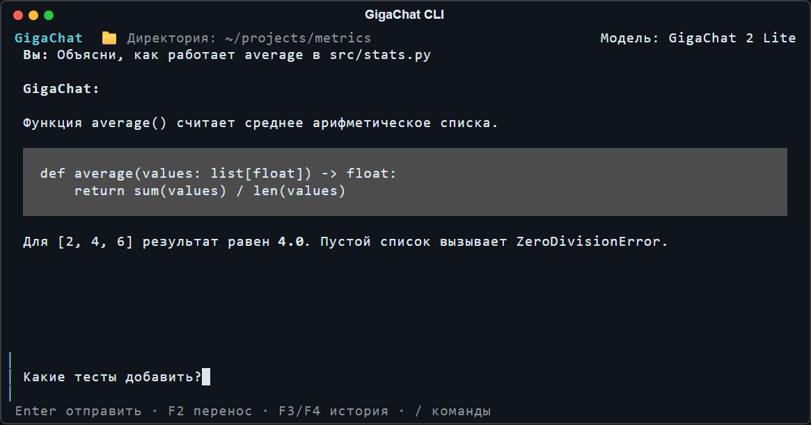
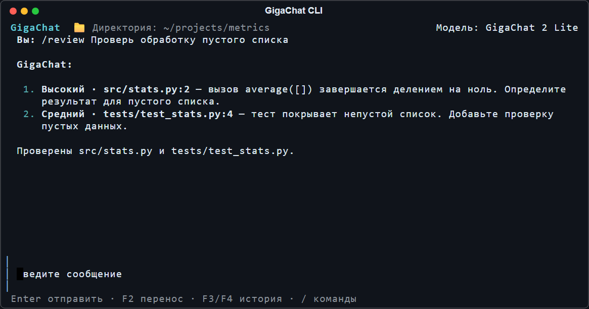
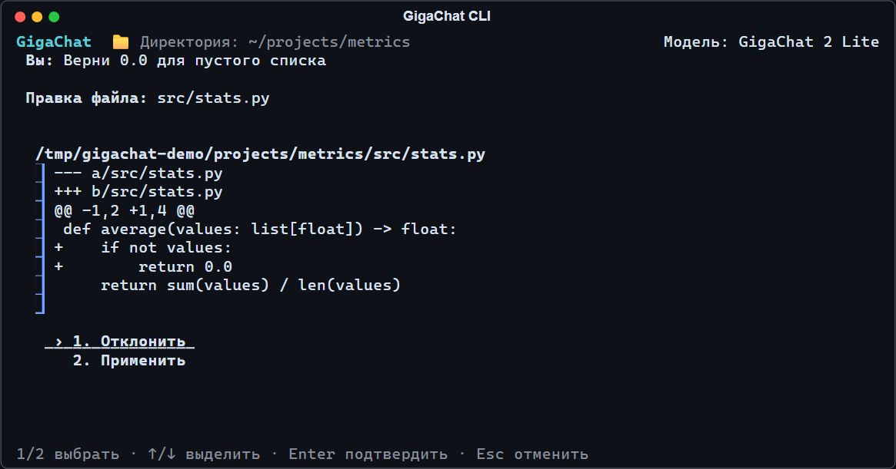

<h1 align="center">GigaChat CLI</h1>

<p align="center">
  <strong>Ассистент разработчика в терминале на базе <a href="https://developers.sber.ru/gigachat">GigaChat</a></strong>
</p>

<p align="center">
  Обсуждайте код, проводите ревью проекта и применяйте правки после просмотра diff.
  Для скриптов есть отдельный режим с выводом в текст, JSON и JSON Lines.
</p>

<p align="center">
  <a href="https://pypi.org/project/gigachat-cli/"></a>
  <a href="https://pypi.org/project/gigachat-cli/"></a>
  <a href="https://github.com/THEChrismoth/GigaChat-Cli/actions/workflows/test.yml"></a>
  <a href="LICENSE.md"></a>
  <a href="https://gitverse.ru/THEChrismoth/GigaChat-Cli"></a>
</p>

<p align="center">
  <a href="#быстрый-старт">Быстрый старт</a> ·
  <a href="#работа-в-терминале">Работа в терминале</a> ·
  <a href="#режим-для-скриптов">Режим для скриптов</a> ·
  <a href="#разработка">Разработка</a>
</p>



## Быстрый старт

### Установка

Для Linux, macOS и Windows нужен Python 3.13 или новее. Для установки пакета из PyPI можно использовать [uv](https://docs.astral.sh/uv/).

```sh
uv tool install gigachat-cli
```

<details>
<summary>Другие способы установки</summary>

```sh
pipx install gigachat-cli
```

Для установки в активное окружение Python используйте pip.

```sh
python -m pip install gigachat-cli
```

Для запуска из репозитория следуйте инструкциям в разделе [Разработка](#разработка).

</details>

### Ключ API

Создайте проект в [личном кабинете GigaChat API](https://developers.sber.ru/studio/login) и задайте полученный ключ в окружении терминала.

**Linux и macOS**

```sh
export GIGACHAT_API_KEY="ваш_ключ"
```

**Windows PowerShell**

```powershell
$env:GIGACHAT_API_KEY = "ваш_ключ"
```

### Первый запрос

Откройте терминал в папке проекта и запустите `gigachat`.

```sh
gigachat
```

Попробуйте написать «Покажи структуру проекта» или «Объясни, что делает README.md». Введите `/help`, чтобы увидеть команды прямо в чате. Если API сообщает об ошибке сертификата, укажите [корневой сертификат](#ssl-сертификат).

## Работа в терминале

Чат подхватывает палитру терминала, включая прозрачный фон, если он настроен. В верхней строке видны рабочая папка и модель. Через `/model` можно выбрать GigaChat 2 Lite, Pro или Max.

### Контекст проекта

Упомяните файл в запросе, например «Объясни, что делает src/main.py». CLI передаст модели содержимое поддерживаемого текстового файла размером до 15 000 байт. Для имени без каталога поиск охватывает вложенные папки. Запрос «Покажи структуру проекта» добавляет список файлов и фрагменты ключевых исходников.

### Ревью проекта

В чате можно написать «Сделай ревью проекта» или уточнить задачу с помощью `/review`.

```text
/review Проверь обработку ошибок в cli.py
```

Модель ищет и читает исходники в рабочей папке. Во время ревью доступны только операции чтения, в том числе с `--yolo`. В Git-репозитории для сбора контекста нужен `git` в PATH. При подборе файлов учитываются исключения Git.



### Правки файлов

В чате можно написать «Создай файл test.py с программой привет мир». Команда `/edit` принимает путь и задание.

```text
/edit src/main.py Добавь описание к публичным функциям
/edit "docs/Памятка команды.md" Опиши запуск проекта
```

Просмотрите diff прямо в чате. Нажмите `2`, чтобы применить правку, или `1` / `Esc`, чтобы отклонить. Клавиша `Tab` переводит фокус, стрелки и `Enter` позволяют выбрать действие. По умолчанию выделено отклонение.



- `/fix путь задание` предлагает правку и запускает `python -P -m pytest -q` в рабочей папке после применения правки или при пустом diff. Команде нужен pytest в окружении приложения. При коде завершения `1` модель может предложить ещё одну правку к тому же файлу.
- `/undo` показывает обратный diff последней правки в текущем чате. Для `/fix` он восстанавливает состояние до первой попытки.
- `gigachat --yolo` на один сеанс включает автоматическое применение явных `/edit` и `/fix` внутри папки запуска. Для просьб обычным текстом, правок за пределами папки запуска и `/undo` сохраняется подтверждение.

<details>
<summary>Пути и ограничения правок</summary>

За один раз можно изменить один текстовый файл UTF-8. Для исходного и нового содержимого действует лимит 15 000 байт. Указывайте путь относительно рабочей папки чата и заключайте пути с пробелами и имена без расширения в двойные кавычки. Родительский каталог должен существовать.

Перед предпросмотром приложение проверяет синтаксис Python без исполнения и форматирует новые Python-файлы через Ruff. При изменении файла после подготовки diff приложение сообщит о конфликте. Символические ссылки, служебные пути систем контроля версий и файлы `.env` / `.env.*` исключены из правок.

</details>

### Терминальные команды

Команды с префиксом `!` выполняются прямо в чате.

```text
!git status
!cd src
```

Список путей открывается при вводе аргумента. `Tab` переключает подсказки, `Enter` подставляет выбранный путь. После выбора папки сразу появляются подсказки для её содержимого. Если нужно выполнить команду с выбранной папкой, закройте список через `Esc` и нажмите `Enter`.

Команды запускаются без интерактивного ввода, с ограничением в 60 секунд. На Windows используется `cmd.exe`. Для длинного вывода `!команд` и `/fix` чат показывает последние 8 КиБ и путь к временному файлу с полным логом.

### История и клавиши

При повторном запуске из той же папки восстанавливается последний сохранённый диалог. `/new` начинает новый, `/sessions` показывает список, `/resume ID` открывает нужный. Команда `/exit` закрывает приложение. Диалоги хранятся локально в `~/.gigachat/sessions.sqlite3` в читаемом виде.

| Клавиша | Действие |
| --- | --- |
| `Enter` | Отправить сообщение или подтвердить выбор |
| `F2` | Новая строка. В совместимых терминалах также работает `Shift+Enter` |
| `F3` / `F4` | Предыдущий или следующий запрос из истории ввода |
| `Tab` / `Shift+Tab` | Автодополнение и переход по списку или по элементам интерфейса |
| `↑` / `↓` | Выбор модели или действия в предпросмотре правки |
| `Esc` | Закрыть список или отменить текущую операцию |
| `Ctrl+C` | Прервать выполняемый запрос или команду |

Во время ответа можно прокрутить историю вверх. Чтобы снова следить за генерацией, прокрутите вниз. При отмене чат сохраняет уже полученную часть ответа и черновик следующего сообщения.

<details>
<summary>Что входит в сохранённый диалог</summary>

Сохраняются последние 60 обменов, история ввода и контекст модели. Команды `!` и `/fix` с их выводом, черновики, ожидающие подтверждения правки и откат остаются в открытом чате. Выбранная модель хранится в `~/.gigachat/config.json`.

</details>

## Режим для скриптов

`gigachat -p` отправляет один запрос. Запрос можно передать аргументом или через stdin.

```sh
gigachat -p "Объясни, что делает main.py"
git diff | gigachat -p "Предложи сообщение коммита"
gigachat -p "/review Проверь обработку ошибок" --output-format json
gigachat -p "Кратко опиши структуру проекта" --output-format stream-json
```

| Параметр | Что делает |
| --- | --- |
| `-p`, `--print [PROMPT]` | Отправляет запрос. При наличии аргумента stdin добавляется к нему |
| `--output-format text` | Печатает ответ по мере генерации, ошибки идут в stderr. Формат по умолчанию |
| `--output-format json` | Печатает один объект с ответом или ошибкой |
| `--output-format stream-json` | Печатает события `start`, `chunk` и `result` в формате [JSON Lines](https://jsonlines.org/) |
| `--model MODEL` | Выбирает модель на один запуск, например `GigaChat-2-Max` |
| `--version`, `--help` | Показывает версию или справку |

<details>
<summary>Пример JSON и коды возврата</summary>

```json
{
  "type": "result",
  "is_error": false,
  "result": "В main.py определяется точка входа приложения.",
  "error": null,
  "model": "GigaChat-2",
  "files": ["main.py"],
  "duration_ms": 2497
}
```

В `stream-json` событие `start` содержит модель, событие `chunk` — фрагмент в поле `content`, а завершающее `result` использует поля объекта выше. Вывод кодируется в UTF-8.

| Код | Значение |
| --- | --- |
| `0` | Успех |
| `1` | Ошибка при обработке запроса |
| `2` | Неверные аргументы или пустой запрос |
| `130` | Запрос прерван через `Ctrl+C` |

</details>

## Решение проблем

### SSL-сертификат

При ошибке `CERTIFICATE_VERIFY_FAILED` скачайте [корневой сертификат Минцифры](https://www.gosuslugi.ru/crt) в формате PEM и задайте путь к нему.

```sh
export GIGACHAT_CA_BUNDLE_FILE="/path/to/russian_trusted_root_ca.cer"
```

```powershell
$env:GIGACHAT_CA_BUNDLE_FILE = "C:\certs\russian_trusted_root_ca.cer"
```

Файл в формате PEM начинается со строки `-----BEGIN CERTIFICATE-----`. При диагностике `GIGACHAT_SSL_VERIFY=0` отключает проверку сертификата и вместе с ней проверку подлинности сервера. Если переменная не задана, учитываются стандартные параметры SDK, включая `GIGACHAT_VERIFY_SSL_CERTS`.

<details>
<summary>Ключ API не виден в приложении</summary>

Эти команды проверяют наличие переменной в текущем терминале и выводят только статус.

```sh
test -n "$GIGACHAT_API_KEY" && echo "Ключ задан"
```

```powershell
if ($env:GIGACHAT_API_KEY) { "Ключ задан" }
```

Если ключ задан в системных переменных Windows, заново откройте терминал или редактор.

</details>

<details>
<summary>Команда запускает старую версию</summary>

Выполните `gigachat --version` и проверьте установки через `uv tool list`, `pipx list` и `python -m pip show gigachat-cli`. Для запуска версии из текущего репозитория используйте `uv run gigachat`.

</details>

<details>
<summary>Ошибка <code>unable to infer type for attribute "x_headers"</code></summary>

Обновите GigaChat CLI через тот же инструмент, которым он был установлен. На Python 3.14 приложению нужен Pydantic 2.13 или новее для совместимости с SDK GigaChat.

</details>

## Разработка

```sh
git clone https://github.com/THEChrismoth/GigaChat-Cli.git
cd GigaChat-Cli
uv sync --locked
uv run gigachat
uv run --locked pytest
uv run --locked ruff check src tests
```

Архитектура, стандарты кода и проверки описаны в [руководстве разработчика](docs/DEVELOPMENT.md). Правила работы с репозиторием находятся в [AGENTS.md](AGENTS.md).

[Выпуски на GitHub](https://github.com/THEChrismoth/GigaChat-Cli/releases) · [Сообщить об ошибке](https://github.com/THEChrismoth/GigaChat-Cli/issues) · [Зеркало на GitVerse](https://gitverse.ru/THEChrismoth/GigaChat-Cli) · [Лицензия MIT](LICENSE.md)
